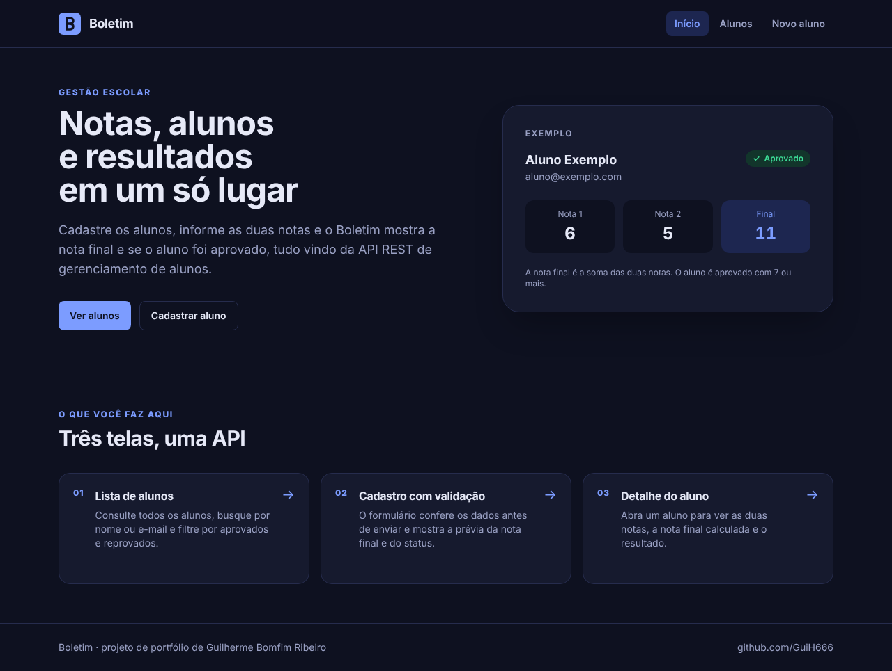
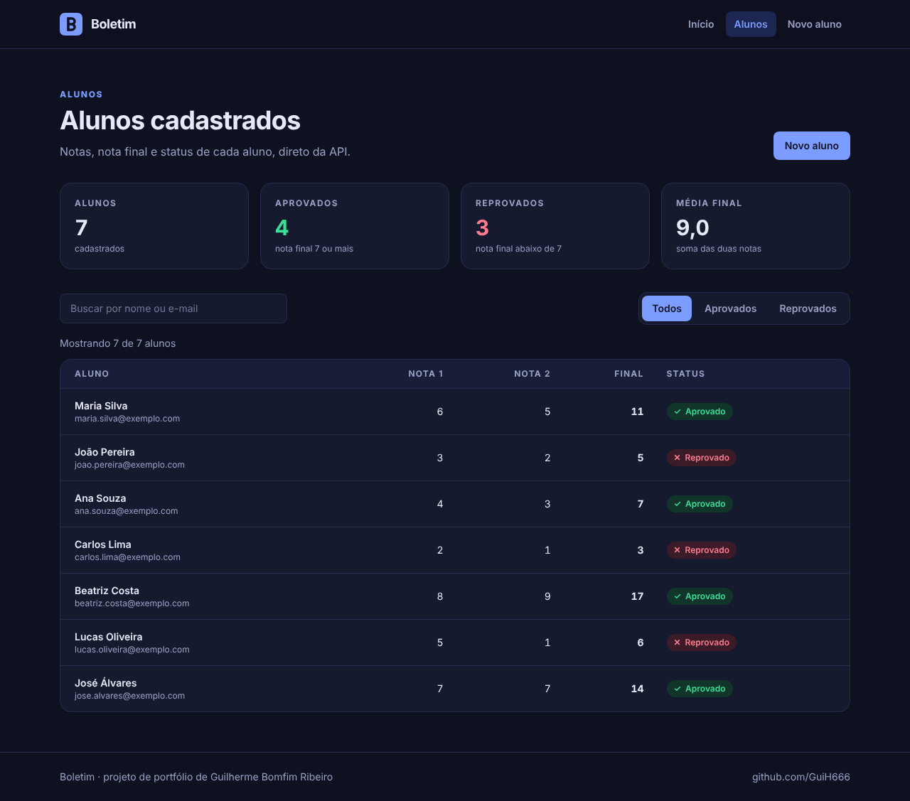
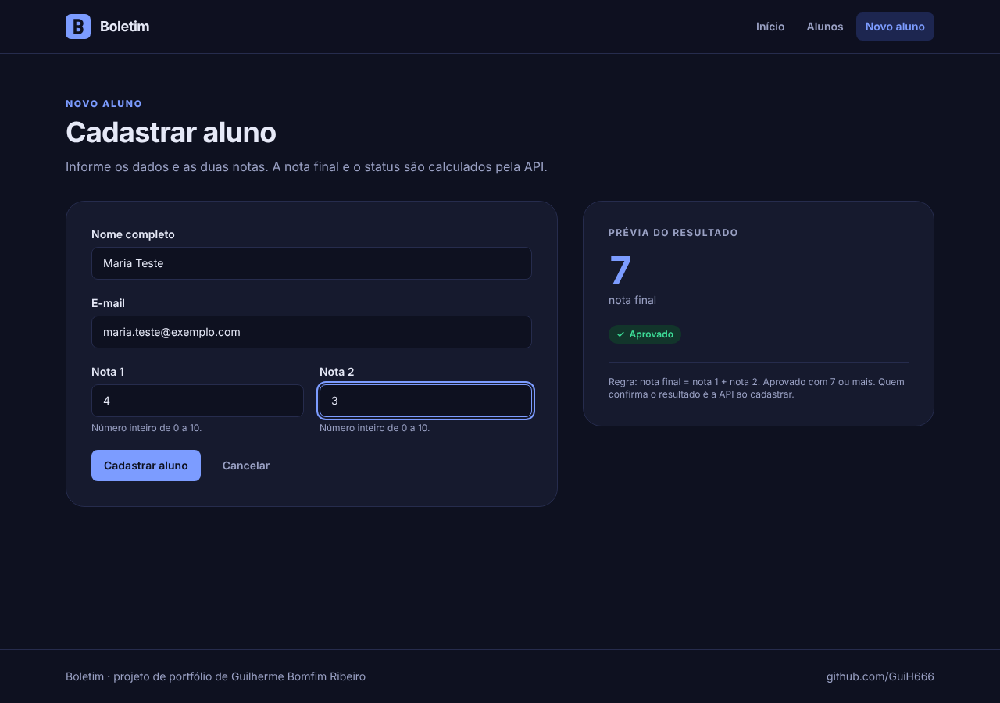
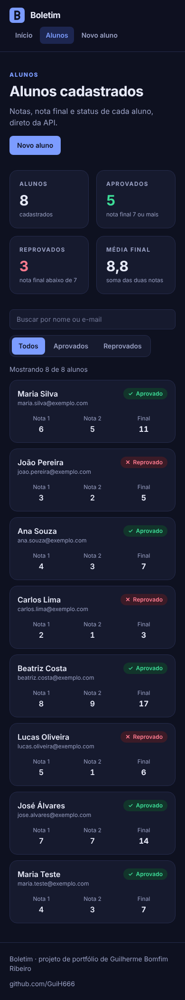

# Boletim

Front-end em **React + TypeScript** para a [API de Gerenciamento de Alunos](https://github.com/GuiH666/API-de-Gerenciamento-de-Alunos). Lista os alunos, mostra o resultado de cada um e cadastra novos, tratando os estados de **carregando, erro e lista vazia** em todas as telas.

<p align="left">
  
  
</p>
<p align="left">
  
  
</p>

## Funcionalidades

- **Lista de alunos** com indicadores (total, aprovados, reprovados e média), busca por nome ou e-mail (ignora acentos) e filtro por status.
- **Detalhe do aluno** com as duas notas, a nota final e o resultado, e tela própria para aluno não encontrado (404).
- **Cadastro** com validação antes do envio, mensagens de erro por campo, **prévia da nota final** enquanto se digita e exibição do erro devolvido pela API.
- **Estados de tela**: carregando (skeleton), erro com botão "Tentar de novo" e lista vazia, em todas as páginas que usam dados da API.
- **Responsivo**: tabela no computador, cartões no celular.
- **Acessibilidade**: rótulos ligados aos campos, erros anunciados por leitores de tela, foco no primeiro campo inválido, status com texto e símbolo (não só cor) e contraste mínimo de 4,5:1.

## Tecnologias

React 19 · TypeScript · Vite · Tailwind CSS 4 · TanStack Query · TanStack Router · Axios

## Como executar

Você precisa do **Node.js 20 ou mais novo** e da API de alunos rodando.

1. **API**: na pasta da API, confira o `.env` (veja o `.env.example`) e inicie com `node index.js`. Ela sobe em `http://localhost:3000`.
2. **Front-end**: nesta pasta, rode:

```bash
npm install
npm run dev
```

3. Abra **http://localhost:5173**. A porta é fixa porque a API libera CORS só para esse endereço (configurável por `CORS_ORIGIN` no `.env` da API).

Para apontar para outra API, copie `.env.example` para `.env` e altere `VITE_API_URL`.

Outros comandos: `npm run typecheck` (confere os tipos) e `npm run build` (gera a versão de produção em `dist/`).

## Estrutura

```
src/
├── main.tsx            Entrada: QueryClient + Router
├── router.tsx          Rotas (/, /alunos, /alunos/novo, /alunos/:id)
├── index.css           Tailwind + paleta de cores (tema)
├── lib/
│   ├── api.ts          Cliente Axios e tratamento de erros
│   ├── alunos.ts       Tipos, regras de negócio e validação do formulário
│   └── format.ts       Formatação de números e busca sem acento
├── hooks/useAlunos.ts  Consultas e cadastro com TanStack Query
├── components/         Layout e componentes reutilizáveis (ui/)
└── pages/              Uma página por tela
```

## Decisões de projeto

- **Estado do servidor com TanStack Query.** A lista tem uma chave de cache; depois de cadastrar, a chave é invalidada e a lista é buscada de novo sozinha. Quando o aluno não existe (404), não há nova tentativa.
- **Regras de negócio em um só lugar** (`lib/alunos.ts`): o formulário valida com as mesmas regras da API (campos obrigatórios, notas inteiras de 0 a 10) e calcula a prévia do resultado. Quem decide o resultado final é sempre a API.
- **Erros legíveis.** `mensagemDeErro` transforma erros de rede, de tempo esgotado e respostas da API (400, 404, 500) em frases para o usuário.
- **Tema centralizado.** Todas as cores ficam em `src/index.css`; trocar a identidade visual é mudar esse bloco.

## Próximos passos

- Edição e exclusão de alunos (`PUT` e `DELETE` na API).
- Testes automatizados dos componentes e das regras de validação.
- Publicação (front-end e API) com endereço público.

## Autor

**Guilherme Bomfim Ribeiro** · [GitHub](https://github.com/GuiH666) · [LinkedIn](https://www.linkedin.com/in/guilherme-bomfim-ribeiro-2623aa218/)
